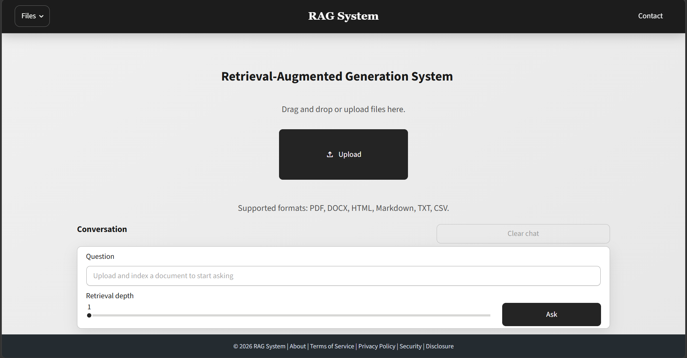

# RAG System

A retrieval-augmented generation (RAG) app that answers questions from uploaded content and cites the supporting passages.

## Features

- Upload PDF, DOCX, HTML, Markdown, TXT, and CSV files
- Extract text and split documents into overlapping chunks
- Create embeddings with OpenAI `text-embedding-3-large`
- Store and search document chunks in Qdrant using vector and lexical ranking
- Ask follow-up questions with recent conversation context
- Inspect cited passages with page numbers or chunk references when available
- View and delete indexed documents from the main-page library
- Run ingestion and query workflows asynchronously through Inngest

## How It Works

The Streamlit app sends uploaded files to FastAPI. Inngest runs the ingestion workflow, which extracts and chunks the text, creates embeddings, and stores the chunks in Qdrant. For a question, the app retrieves relevant chunks and sends that context to `gpt-4o-mini` to generate a grounded answer with citations.

## Getting Started

### Prerequisites

- Docker with Docker Compose
- Node.js and `npx` for the local Inngest development server
- An OpenAI API key with access to the embedding and chat models

### Installation

1. Create a `.env` file in the project root:

	```env
	OPENAI_API_KEY=your_openai_api_key
	```

2. Install the Python dependencies:

	```bash
	uv sync
	```

3. Start Qdrant:

	```bash
	docker compose up -d
	```

4. Start the Inngest development server in a separate terminal:

	```bash
	npx --yes inngest-cli@latest dev
	```

5. Start the FastAPI app in another terminal:

	```bash
	uv run uvicorn main:app --reload --port 8000
	```

6. Start the Streamlit app in another terminal:

	```bash
	uv run streamlit run streamlit_app.py
	```

Open Streamlits localhost url http://localhost:8501

## Live Demo
[https://rag-system-443d.up.railway.app/](https://rag-system-443d.up.railway.app/)

## Screenshots


## License

Distributed under the MIT License. See [LICENSE](LICENSE) for more information.